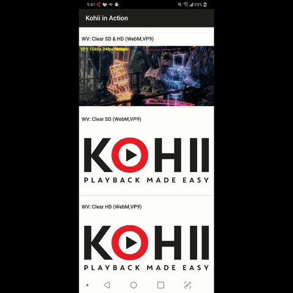

# Kohii

## kohii (コーヒー、[[ko̞ːçiː]](https://en.wiktionary.org/wiki/%E3%82%B3%E3%83%BC%E3%83%92%E3%83%BC))


Video playback for Android made easy.

[](https://jitpack.io/#Akaizz/kohii)

This is a fork of [eneim/kohii](https://github.com/eneim/kohii) migrated from ExoPlayer 2 to
[AndroidX Media3](https://developer.android.com/media/media3) and published through JitPack. See
[CHANGELOG.md](CHANGELOG.md) for what changed from the original library.

**Kohii** is a powerful, easy to use and extensible Video playback library. **Kohii** provides
powerful features out of the box, including

1. Easy to start: just one line to start a Video playback.
2. Automatic playback experience on RecyclerView, NestedScrollView, ViewPager2, etc.
3. Configuration change handling works out of the box, including the transition from local playback
   to fullscreen playback and vice versa.
4. Feature-rich sample apps that cover either simple or advanced use cases.
5. Extension-based structure: `kohii-core` holds the playback management logic, and
   `kohii-exoplayer` plays the videos with Media3 ExoPlayer.

## Demo

|Automatic playback|Playback continuity (Seamless fullscreen)|
| :--- | :--- |
|||

## Setup

Add the JitPack repository:

```groovy
// settings.gradle (or top level build.gradle)
repositories {
  google()
  mavenCentral()
  maven { url "https://jitpack.io" }
}
```

Then add the dependency to your module's build.gradle:

```groovy
// <version> is a git tag (for example 2.0.2-media3), a commit hash, or <branch>-SNAPSHOT
// (for example main-SNAPSHOT).
implementation "com.github.Akaizz.kohii:kohii-exoplayer:<version>" // also brings kohii-core
```

`kohii-exoplayer` brings Media3 ExoPlayer (`androidx.media3:media3-exoplayer`, `media3-ui`) and the
DASH, HLS and SmoothStreaming modules transitively.

If your app also declares Media3 modules, use **the same Media3 version as Kohii (1.10.1)** for all
of them. `KohiiExoPlayer` implements `ExoPlayer`, so it only knows the methods of the Media3 version
Kohii was built with: with a newer Media3, calling a method added later crashes with
`AbstractMethodError`.

## Start a playback

```Kotlin tab=
// Kotlin
// 1. Initialization in Fragment or Activity
val kohii = Kohii[this@Fragment]
kohii.register(this /* Fragment or Activity */).addBucket(this.recyclerView)

// 2. In ViewHolder or Adapter: bind the video to the PlayerView inside a child of the RecyclerView.
// playerView is an androidx.media3.ui.PlayerView.
kohii.setUp(videoUrl).bind(playerView)
```

```Java tab=
// Java
// 1. Initialization in Fragment or Activity
Kohii kohii = Kohii.get(this);
kohii.register(this).addBucket(this.recyclerView);

// 2. In ViewHolder or Adapter: bind the video to the PlayerView inside a child of the RecyclerView.
kohii.setUp(videoUrl).bind(playerView);
```

## Requirements

- Android 7.0+ (min SDK 24), compile SDK 36 (required by Media3 1.10).
- Kotlin 2.x: the library is built with Kotlin 2.1.0, and Media3 1.10 contains Kotlin 2 code that
  Kotlin 1.x cannot read. Java callers are supported too.
- Media3 1.10.1, if your app declares Media3 modules itself (see [Setup](#setup)).

## License

Apache License 2.0, see [LICENSE](LICENSE). Original work by
[Nam Nguyen (eneim)](https://github.com/eneim).
